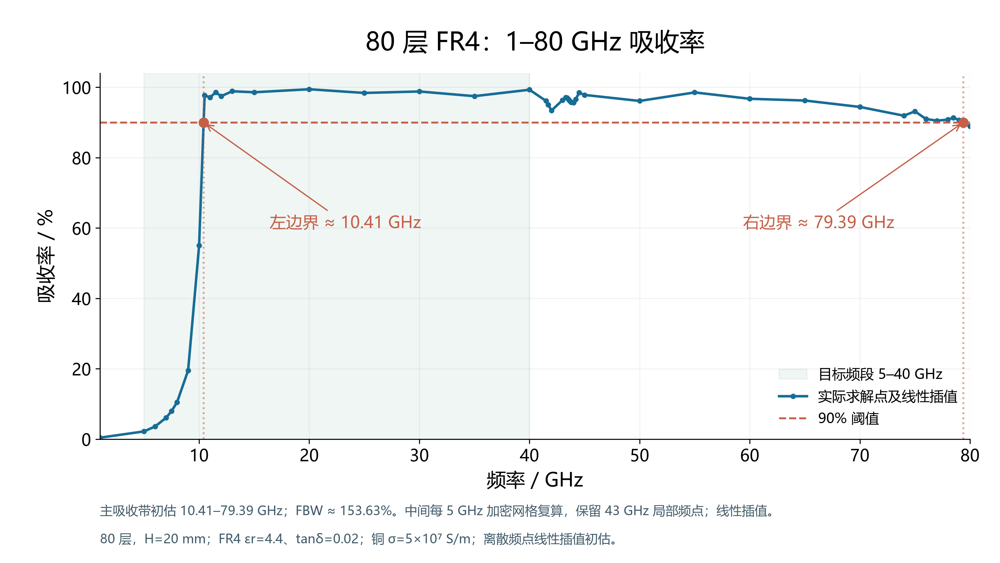

# 80 层 FR4 金字塔吸波器：当前结果

本页是 **`absorber` 分支**的当前结果。结构保持 80 层、总高 20 mm，使用论文 FR4 参数近似（εr=4.4、tanδ=0.02）和有限电导率铜。最新图使用实际离散频点的**线性插值**。



## 当前数值

| 项目 | 插值初估 |
| --- | --- |
| 左侧 90% 交点 | **10.41 GHz**，由 10 / 10.5 GHz 实际求解点夹逼 |
| 右侧 90% 交点 | **79.39 GHz**，由 79 / 80 GHz 实际求解点夹逼 |
| 相对带宽 FBW | **153.63%**，按 `2(fH−fL)/(fH+fL)` 计算 |
| 中间采样 | 15–75 GHz 每隔 5 GHz 重算，使用分组细化网格 |
| 43 GHz 附近 | 保留 41.5–44.5 GHz 的 13 个局部直接求解点 |

**这版 FR4 结构尚不满足 5–40 GHz 全带吸收率 ≥90% 的设计目标。** 带宽为分段离散数据的插值初估，未完成完整连续扫频和全频段网格独立性认证。材料未引入实测频散、制造公差或铜粗糙度。

## 当前工程、数据和代码

- [CST 入口工程：80 层 FR4、1–80 GHz 设置](cst/absorber.cst)：仅整理模型和采样设置，**未声称该入口文件新完成了一次完整扫频**。
- [结果说明和复现方法](absorber/README.md)。
- [实际运行的 8 组分段 CST 源工程及导出数据](absorber/cases/)。
- [1–80 GHz 高清 PNG](absorber/figures/02_absorption_1_80.png) · [SVG 矢量图](absorber/figures/02_absorption_1_80.svg)。
- [合并离散频谱 CSV](absorber/data/merged_discrete_spectrum.csv) · [整五频点及网格统计](absorber/data/middle_5GHz_refinement.csv) · [边界和数据来源 JSON](absorber/data/boundary_summary.json)。
- [绘图代码](absorber/scripts/plot_results.py)及[仿真代码](absorber/scripts/)。

从仓库根目录重画已发布的图：

```powershell
python -m pip install -r absorber/requirements.txt
python absorber/scripts/plot_results.py --mid5GHz
```

原来的 `P05_loss18_full/` 等目录、根目录的 `figures/` 和 `scripts/` 继续保留作历史记录，主要对应 **εr=22、tanδ=0.18 的设计介质**，不能与当前 FR4 结果混用。当前图、代码和数据入口均在 `absorber/` 中。

参考：Ding et al., *Applied Physics Letters* **100**, 103506 (2012), [doi:10.1063/1.3692178](https://doi.org/10.1063/1.3692178)。本次 80 层结构是后续设计，不是论文原始 20 层结构的原样复现。

<details>
<summary>历史版本目录说明（高介电常数设计介质，非当前 FR4 结果）</summary>

以下为保留的旧说明：

P05_loss18_full：最终达标主工程，打开 absorber.cst；保留完整CST结果目录。
P06_critical_stability_screen：12.23GHz独立网格收敛复核工程。
figures：五张最终结果图片。
stability_40GHz：40GHz有效复核数据。
comparison_data：绘图使用的对比数据。
scripts：建模、评估和绘图脚本。
final_selection.json：最终方案与验证数值。

法向入射下完整5–40GHz扫频通过；最低吸收率92.49%，最差S11约-11.25dB，相对带宽155.56%。
设计介质参数εr=22、tanδ=0.18，区别于参考论文FR4。

</details>
