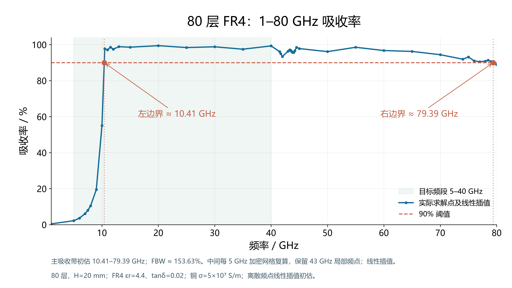

# 当前 80 层 FR4 工程与 1–80 GHz 图



## 结构与材料

80 层铜—FR4 叠层，总高 20 mm，周期 7.2 mm，底宽 6.9 mm、顶宽 0.65 mm，对数渐变的阶梯方形截面。每层铜厚 0.05 mm、FR4 厚 0.20 mm。FR4 采用论文参数 εr=4.4、tanδ=0.02，铜电导率为 5×10⁷ S/m。激励为理想周期阵列下的法向 TE(0,0) 入射。

吸收率按 `A=1−R−T` 计算，R、T 累加全部已包含的**传播** Floquet 模态功率，截止以下的倏逝模态不计入远场功率。原始复数 S 参数和 CST 模态截止频率一并保存。

## 当前边界

- 左边界约 **10.4097 GHz**：10 GHz 吸收率 55.01%，10.5 GHz 为 97.71%，两点线性插值。
- 右边界约 **79.3852 GHz**：79 GHz 吸收率 90.68%，80 GHz 为 88.92%，两点线性插值。
- 主吸收带的离散点插值初估为 **10.41–79.39 GHz**，相对带宽约 **153.63%**。
- **当前结构未满足 5–40 GHz 连续吸收率 ≥90% 的原始目标。** 5 GHz 重新计算吸收率约 2.20%。

这是分段网格与离散采样结果，不能排除相邻频点之间的未采样窄带凹陷。固定 FR4 参数不是实测宽频材料频散，也未加入制造公差、粗糙度或有限阵列边缘。

## 网格与来源

各自适应网格组使用二阶四面体频域求解器，停止阈值 ΔS≤0.02，线性方程组容差 10⁻⁵；两者均不能直接解释为吸收率误差。

| 来源 | 自适应频率 | 最终网格单元 | 最后 ΔS |
| --- | --- | ---: | ---: |
| [左边界](cases/FR4_80layer_left_mesh_check_screen/) | 10.5 GHz | 19,983 | 0.0199397 |
| [15–30 GHz 整五频点](cases/FR4_80layer_mid15_30_5GHz_screen/) | 30 GHz | 33,227 | 0.0115536 |
| [35–50 GHz 整五频点](cases/FR4_80layer_mid35_50_5GHz_screen/) | 50 GHz | 38,756 | 0.00689952 |
| [55–70 GHz 整五频点](cases/FR4_80layer_mid55_70_5GHz_screen/) | 70 GHz | 62,094 | 0.00776258 |
| [75 GHz](cases/FR4_80layer_75GHz_refined_screen/) | 75 GHz | 66,368 | 0.00937965 |
| [右边界](cases/FR4_80layer_right_mesh_check_screen/) | 78 GHz | 74,580 | 0.0122682 |

组内频点直接求解，共用该组的细化网格；没有声称各组内频率分别独立完成自适应。

[43 GHz 附近的 13 个点](cases/FR4_80layer_43GHz_direct_screen/)保留原值，使用 15,632 单元的初始网格，按要求未继续加密。旧中止扫频的拟合在 43.6 GHz 给出约 61.35%，新直接求解约 96.32%；见[对比图](figures/05_43GHz_recheck.png)。40、45 GHz 两个整五频点采用新细化网格求解结果。

[早期粗算](cases/FR4_80layer_quick_boundary_screen/)仅用于网格对照及 80 GHz 以上的对照数据。当前主图的整五频点已采用新数据。

## 文件入口

- [`../cst/absorber.cst`](../cst/absorber.cst)：统一的 **1–80 GHz 模型设置入口**。从实际分段工程另存生成，未新增整带求解；不能把组合曲线当作该文件的一次完整扫频结果。
- `cases/<case>/absorber.cst`：各分段实际运行时的模型设置。
- 每个 case 包含参数、指标、频谱 CSV、复数 S 参数 JSON、模态截止频率、VBA 历史及 `solver_output.txt`。日志中的本机绝对目录已替换成占位符。
- 大体积原生网格、场数据和临时求解缓存保留在本地，未加入新的 Git 数据包。`.cst` 可打开模型，导出数据记录数值；新的原生结果需重新求解。
- [`data/merged_discrete_spectrum.csv`](data/merged_discrete_spectrum.csv)的 `source_case` 列逐点标明来源。
- [`data/main_project_info.json`](data/main_project_info.json)记录统一入口的来源与采样设置。
- 图线均采用实际频点之间的线性插值。旧约 7.5 GHz 左交点和 43 GHz 深凹陷的中止扫频拟合不再用于当前曲线。

## 重画发布图

从仓库根目录运行，使用现代 Python：

```powershell
python -m pip install -r absorber/requirements.txt
python absorber/scripts/plot_results.py --mid5GHz
```

输出 PNG、SVG 到 `absorber/figures/`，数值输出到 `absorber/data/`。程序验证整五频点、功率守恒和 43 GHz 保留数据的一致性。旧拟合仅在明确标注的对比图中出现。

## 重新求解整五频点（可选）

CST API 需要 Windows、已授权的 CST Studio Suite 2023 和 **64 位 Python 3.6–3.9**。使用 CST 本机安装目录中的官方库，不安装同名第三方 PyPI 包。使用新的输出目录，避免覆盖发布数据：

```powershell
$env:CST_INSTALL_DIR = 'D:\Program Files (x86)\CST Studio Suite 2023'
$env:CST_ABSORBER_RUN = 'C:\cst_runs\fr4_80layer_new'
$cstPython = 'C:\path\to\python39.exe'
& $cstPython absorber/scripts/run_fr4_mid5GHz_batch.py
& $cstPython absorber/scripts/run_fr4_75GHz_refined.py FR4_80layer_75GHz_refined_screen 80 20 6.9 7.2
# 统计分析使用带 NumPy 的现代 Python。
python absorber/scripts/evaluate_pyramids.py FR4_80layer_mid15_30_5GHz_screen FR4_80layer_mid35_50_5GHz_screen FR4_80layer_mid55_70_5GHz_screen FR4_80layer_75GHz_refined_screen
```

新输出不会自动替换发布数据，复核后再更新相应 case。`prepare_main_project.py` 生成统一入口工程，不执行求解，并拒绝覆盖已有入口文件。

参考：[Ding et al., APL 100, 103506 (2012)](https://doi.org/10.1063/1.3692178)。
