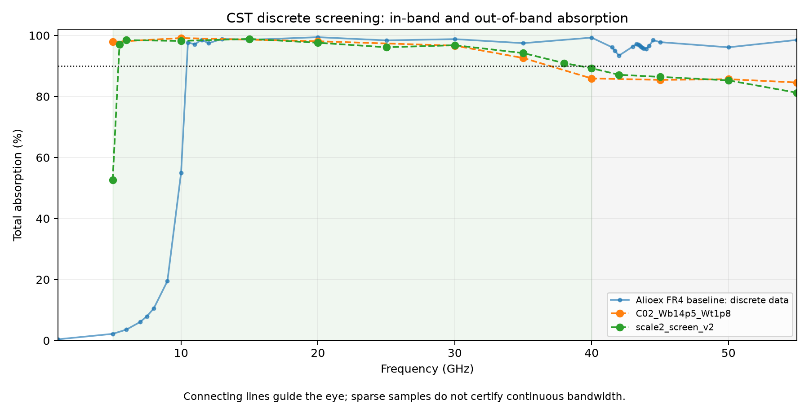

# 2026-11-06 吸波器优化：前两轮真实 CST 筛选结果

**本页是中间结果，不是最终达标方案。第三版正在本机计算，未包含在本次上传中。**

基准为 Alioex 的 absorber 分支提交 `57878837f743ff3fb7128bd9c556cdacaf5b7b0c`。目标是在5–40GHz内获得连续高吸收及>100%相对带宽，同时尽量降低40GHz以上的非目标吸收。带外还没有规定数值门限与过渡带，因此先逐点比较，不宣称已完成带外抑制。

[下载 C01/C02 CST 模型、复数S参数和CSV](C01_C02_models_and_data.zip)

## 参数

|参数|Alioex基准|C01两倍尺寸参考|C02定向改顶宽和底宽|
|---|---:|---:|---:|
|层数|80|80|80|
|总高/mm|20|40|40|
|周期/mm|7.2|14.4|15.1|
|底宽/mm|6.9|13.8|14.5|
|顶宽/mm|0.65|1.3|1.8|
|铜层厚/mm|0.05|0.10|0.10|
|FR4层厚/mm|0.20|0.40|0.40|

FR4固定为εr=4.4、tanδ=0.02，铜电导率5×10⁷S/m，宽度为对数渐变。C01底板保持0.05mm，C02为0.1mm，均不透射。法向TE入射。

## 实际计算的总吸收率

|频率/GHz|C01|C02|
|---|---:|---:|
|5|52.56%|97.88%|
|10|98.21%|99.15%|
|20|97.61%|98.10%|
|30|96.80%|96.66%|
|35|94.23%|92.62%|
|40|89.25%|85.92%|
|45|86.43%|85.44%|
|50|85.28%|85.67%|
|55|81.23%|84.58%|

**结论：**C02使5GHz吸收提高到97.88%，但40GHz仅85.92%；45/50/55GHz平均吸收为85.23%，未优于C01的84.31%。因此增大顶宽没有解决带外吸收，C02不能作为最终提交的达标设计。

## 验证范围与注意事项

- C01完成15个离散频点，C02完成9个离散频点；图中连线仅辅助阅读，不能证明点间连续达标。
- 两轮均采用二阶四面体频域求解、40GHz网格自适应，最后ΔS分别为0.01294和0.01042，达到本轮0.02筛选阈值。尚无最终独立网格收敛认证。
- A=1−R−T；反射和透射累加全部传播Floquet模态功率。周期较大，高频出现衍射，不能仅用主模S11判断吸收率。C01在40GHz主模S11=-16.74dB，但总吸收只有89.25%。
- 工程包不含大型原生网格和场缓存；包含模型设置、实际复数S参数、模态截止频率、CSV、建模VBA和求解摘要。打开CST后若需原生结果，应重新求解。
- 材料为固定参数近似，未引入实测宽频频散或制造公差。

## 设计依据和第三版

Ding等人的论文指出局部谐振频率近似与贴片宽度成反比：底宽控制低频端、顶宽主要控制高频端；不是精确的截止频率闭式公式。[论文DOI](https://doi.org/10.1063/1.3692178)。

第三版C03正在检验减薄是否能改善带外：N=80,H=20mm,P=15.1mm,Wb=14.5mm,Wt=1.3mm,tm=0.05mm,td=0.20mm。**尚未发布其性能结论。**
